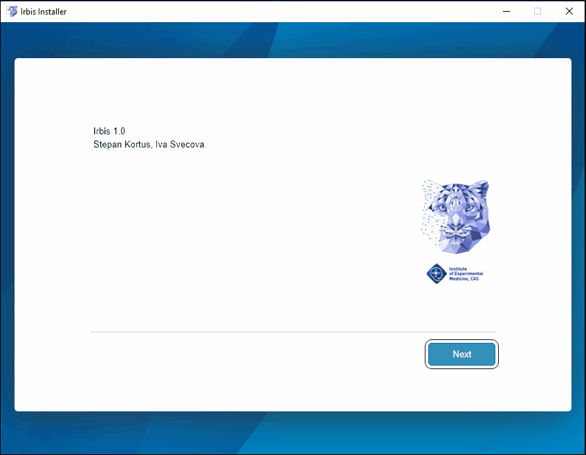

# Installation

## Irbis software 
1. Download the Irbis installer from [the download page](https://microscopy.iem.cas.cz/download-irbis/). 
2. Double-click the downloaded `.exe` file to start the installation. 
3. The installation wizard will open. Follow the instructions to complete the installation.

 

The Irbis installer automatically downloads and installs MATLAB Runtime, which is required to run Irbis. MATLAB Runtime is provided free of charge, and no MATLAB license is required.

## Python environment
Some Irbis functions require Python.
A predefined conda environment containing Python and all required libraries is bundled with the Irbis installer. You do not need to install or configure Python separately.

When Irbis is opened for the first time, the bundled environment is automatically extracted to the local application data folder and configured for use by Irbis.

On Windows, the default location is:
`C:\Users\<username>\AppData\Local\IrbisApp\python`
