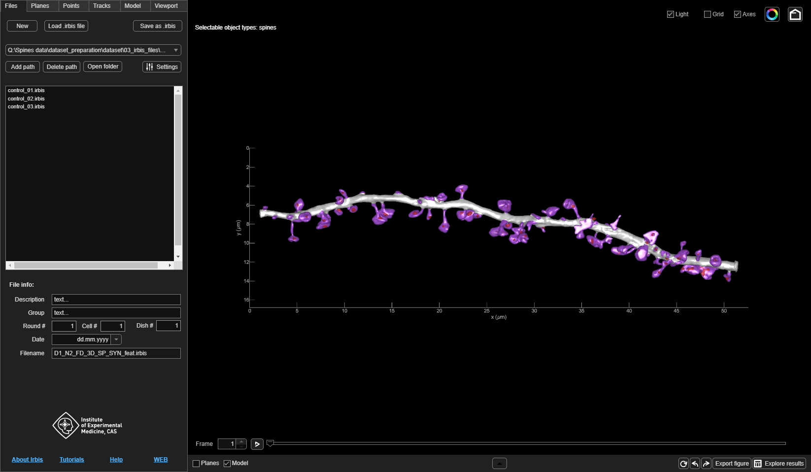

# Irbis documentation

Welcome to the Irbis documentation.

Irbis is an open-source software for analysis of multimodal fluorescence microscopy data, with a primary focus on 3D and time-lapse analysis of dendritic spines. It provides an end-to-end graphical interface covering image preprocessing, 3D reconstruction, segmentation, quantitative analysis and data exploration, combining automated analysis algorithms with extensive manual editing tools.

Use the tutorials to learn Irbis through complete guided workflows. Use the step-by-step guides when you already know the app and need help with a specific task.

## Start here

- New to Irbis: [Getting started](getting-started.md)
- Learn the basic workflow: [Segment dendritic spines from a single time point](tutorials/segment-spines.md)
- Explore guided workflows: [Tutorial flows](tutorials/index.md)
- Look up a specific task: [Step-by-step guides](step-by-step/index.md)
- Check file and parameter details: [Reference](reference/index.md)

## Main areas

- [Data import and saving](step-by-step/data-import/index.md)
- [Planes processing](step-by-step/planes/index.md)
- [3D model processing](step-by-step/model/index.md)
- [Tracks processing](step-by-step/tracks/index.md)
- [ResultsViewer](step-by-step/results-viewer/index.md)
- [Visualization and navigation](step-by-step/visualization-and-navigation/index.md)
- [Views and animations](step-by-step/viewport/index.md)

## Reference

- [Irbis file structure](reference/irbis-file-structure.md)
- [Object data tables](reference/parameters/index.md)
- [Object connection](reference/spine-generation-parameters/greedy-object-connection.md)
- [Spine generation parameters](reference/spine-generation-parameters/index.md)

## Contact

- [Contact and project information](contact.md)
