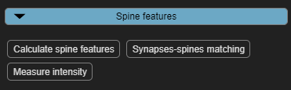

# Calculate spine features

Calculate spine-level measurements after the spine objects have been separated and corrected. These values are stored with the spine objects and can be inspected later in ResultsViewer.

!!! info "Before you start"
    **Prerequisites:**

    - Spines separated from the shaft.
    - Obvious merged or incorrectly cut spines corrected.

    **UI location:**

    - Main app: **Model** tab, **Spines** subtab, **Spine features** section.

## Calculate morphology features

1. Go to **Model** > **Spines**.
2. Open **Spine features**.
3. Press **Calculate spine features**.
4. Wait until feature calculation finishes.
5. Review the generated values in [ResultsViewer](../results-viewer/index.md).

The exact available columns depend on the generated model and the feature-calculation code. For the object-feature reference, see [Object features](../../reference/parameters/object-features.md).

## Match synapses to spines

Use **Synapses-spines matching** when synapse objects are available and should be associated with spine objects.

1. Confirm that both spine objects and synapse objects are present.
2. Press **Synapses-spines matching**.
3. Review the resulting spine-synapse assignments in the object tables or ResultsViewer.

## Measure intensity

Use **Measure intensity** when intensity values from the image data should be measured for spine objects.

1. Confirm that the source image channel is available.
2. Press **Measure intensity**.
3. Review the added intensity columns in ResultsViewer.

## Next steps

- Continue to [Classify spines manually](classify-spines-manually.md) if manual categories are needed.
- Use [Export model objects](export-model-objects.md) to export meshes or masks.
