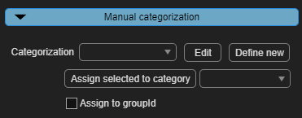

# Classify spines manually

Use manual categorization to assign selected spines to user-defined classes, such as morphological spine classes or quality-control labels.

!!! info "Before you start"
    **Prerequisites:**

    - Spine objects generated.
    - Spine features calculated, if the category assignment should be based on measured values.

    **UI location:**

    - Main app: **Model** tab, **Spines** subtab, **Manual categorization** section.

## Create or select a categorization

1. Go to **Model** > **Spines**.
2. Open **Manual categorization**.
3. Select an existing categorization from **Categorization**, or press **Define new** to create one.
4. Use **Edit** to adjust the selected categorization.

## Assign selected spines

1. Select one or more spines in the visualization panel or in the **Object list**.
2. Choose the target category from the category drop-down menu.
3. Press **Assign selected to category**.
4. Check the selected spines or the object table to confirm the assignment.

Check **Assign to groupId** when the assignment should follow the tracked object group instead of only the currently selected object instance. This is useful for time-lapse data where the same spine has a shared group ID across time points.

## Next steps

- Use [Visualize and adjust model objects](visualize-model-objects.md) to color-code objects by stored parameters where supported.
- Use [Export model objects](export-model-objects.md) to export meshes or masks.
