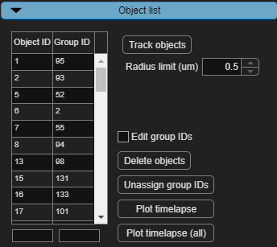

# Connect objects in time

Use object tracking to connect corresponding model objects across time points. Connected objects share the same group ID.

!!! info "Before you start"
    **Prerequisites:**

    - Primary 3D model created for all time points.
    - Time drift corrected.

    **UI location:**

    - Main app: **Model** tab, object-type subtab.
    - **Object list** section.

## Steps

1. Open **Object list**.
2. Review the object IDs and group IDs. Each spatially separated object appears as a separate item.
3. Set **Radius limit (um)** to the largest expected movement between consecutive time points (after drift correction has been applied).
4. Press **Track objects**.
5. Check the connection by selecting an object in the list or visualization window and moving through time points.
6. Confirm that the object keeps the same group ID, shown in brackets next to the model.
7. If objects are not connected correctly, adjust **Radius limit (um)** and press **Track objects** again.

## How automatic connection works

Automatic object connection assigns group IDs by matching objects in consecutive time points. Irbis compares object positions and, when available, object volumes. Objects are connected only when they are within the selected radius limit.

For details, see [Greedy object connection in time](../../reference/object-connection/greedy-object-connection.md).

## Manual correction

If automatic connection is wrong, use the object context menu actions **Single: Select next** and **Single: Select previous** to connect objects manually.

1. Select the object you want to correct.
2. Open the context menu.
3. Choose **Single: Select next** or **Single: Select previous**.
4. Select the corresponding object in the next or previous time point.

You can also edit group IDs manually in the **Object list** section by checking **Edit group IDs** and selecting the desired group ID for each row from the dropdown. 

## Next steps

- Continue to [Trace a dendrite](trace-dendrite.md).
- Use [Select and manipulate model objects](object-list-context-menu.md) if automatic matching needs manual correction.
