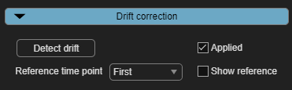
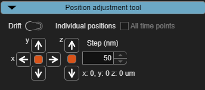

# Detect drift and correct it

Drift correction compensates for global movement of the reconstructed model between time points. If all time points are generated together during 3D reconstruction and **Auto drift correction** is enabled, this step runs automatically.

!!! info "Before you start"
    **Prerequisites:**

    - Primary 3D model created for all time points.

    **UI location:**

    - Main app: **Model** tab, **Full** subtab.
    - Sections: **Drift correction** and **Position adjustment tool**.

## Detect drift

1. In **Drift correction**, press **Detect drift**.
2. By default, the first time point is used as reference.
3. If needed, select a different reference type from the reference drop-down menu.
4. After drift is detected, check **Drift correction** to apply correction.

## Manually adjust drift

Use manual drift adjustment when automatic detection is not accurate enough.

1. Check **Show reference** to display the reference model.
2. In **Position adjustment tool**, set the switch to **Drift**.
3. Select the movement step.
4. Use the arrows to align the model with the reference for the current time point.
5. If the correction is far off, use the red reset buttons in the middle of the arrows. One resets `x-y`, and the other resets `z`.

Drift correction translates all model objects in a time point by the same amount. It is intended for time-dependent movement of the whole reconstructed model.

## Manually adjust individual positions

Use individual position adjustment when selected objects need an additional shift relative to other objects in the same time point. This can be useful, for example, when objects from different channels are shifted relative to each other because of chromatic aberration.

1. In **Position adjustment tool**, set the switch to **Individual positions**.
2. Select the movement step.
3. Select the objects that should be translated. If nothing is selected, all objects in the current branch are translated.
4. Use the arrows to align the selected objects with the reference for the current time point.
5. If the correction is far off, use the red reset buttons in the middle of the arrows. One resets `x-y`, and the other resets `z`.

Individual position shifts are applied on top of drift correction.

!!! warning "Mismatch between drift-corrected model and planes"
    Drift correction shifts model objects, but it does not shift planes data. When Irbis needs to use planes and model objects together, for example during centreline tracing, drift correction is temporarily disabled. For the same reason, a drift-corrected model may not perfectly overlap with the planes when both are shown at the same time. This is expected.

## Next steps

- Continue to [Connect objects in time](connect-objects-in-time.md).

