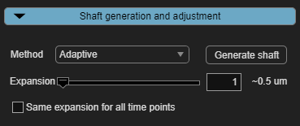
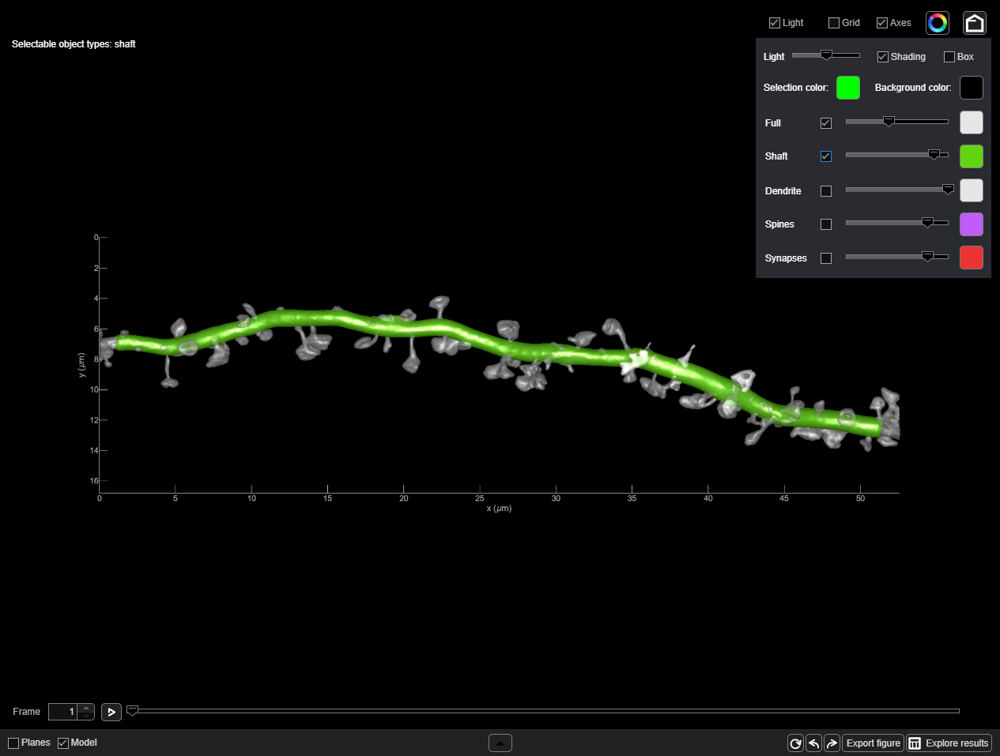
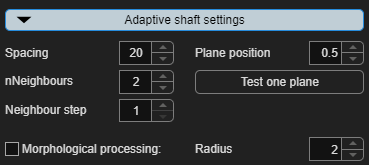

# Generate the dendritic shaft

!!! info "Before you start"
    **Prerequisites:**

    - Primary 3D model created for all time points.
    - Time drift corrected.
    - Objects connected in time.
    - Dendrite tracked.

    **UI location:**

    - Main app: **Model** tab, **Dendrite** subtab.
    - Sections: **Shaft generation and adjustment** and, if used, **Adaptive shaft settings**.

## Choose a shaft method

Irbis can generate the dendritic shaft in two ways. Use **Constant diameter** when a simple tube around the traced dendrite is sufficient. Use **Adaptive** when the shaft radius changes along the dendrite or when the shaft should follow the reconstructed parent mesh more closely.

## Generate a constant-diameter shaft

The constant-diameter method approximates the shaft as a tube around the traced dendrite. This is the simpler option and is useful when the dendritic shaft has a relatively even radius.

1. Select **Constant diameter** from **Method**.
2. Set the shaft **Radius**.
3. To apply the same radius across time points, check **Same radius for all time points**.
4. Adjust **z scale** if needed. A value of `1` creates a circular cross-section; higher values stretch the shaft cross-section along z.
5. Press **Generate shaft**.

## Generate an adaptive shaft

The adaptive method estimates the shaft boundary from the reconstructed parent mesh along the traced dendrite centreline. It is useful when the dendritic shaft does not have a constant radius or when a simple circular tube does not match the reconstructed shape well.

1. Select **Adaptive** from **Method**.
2. Set the shaft **Radius** if the generated shaft needs a global radius adjustment.
3. To apply the same radius adjustment across time points, check **Same radius for all time points**.
4. Open **Adaptive shaft settings**.
5. Tune the adaptive settings, especially **Spacing**, **nNeighbours**, and **neighborStep** when the contour is noisy or misses local shaft changes.
6. Press **Test one plane** to preview one cross-section before applying the settings broadly.
7. Press **Generate shaft**.

If **All time points** is checked in **Dendrite tracing**, the shaft is generated for all time points. Otherwise, it is generated only for the current time point.

## Constant-diameter shaft options

- **Method** selects the shaft-generation method. Choose **Constant diameter** for this workflow.
- **Radius** sets the tube radius directly.
- **Same radius for all time points** applies the selected radius consistently across time points when multiple time points are generated.
- **z scale** changes the shaft cross-section along z for the Constant diameter model. Use `1` for a circular cross-section.

## Adaptive shaft options

- **Method** selects the shaft-generation method. Choose **Adaptive** for this workflow.
- **Radius** can be used to adjust the generated shaft radius after contour extraction.
- **Same radius for all time points** applies the selected radius adjustment consistently across time points when multiple time points are generated.
- **Spacing** controls the distance between centreline positions used to generate mesh slices. Smaller values sample the centreline more densely and may capture local shape changes better, but can increase processing time.
- **nNeighbours** controls how many neighbouring slices on each side are combined when generating one contour. A value of `2` combines the current slice with two slices before and two slices after it. Higher values can stabilize noisy contours, but may smooth over local changes.
- **neighborStep** controls the step between neighbouring slices selected by **nNeighbours**. Use `1` to combine adjacent slices; higher values combine every nth neighbouring slice, which widens the sampling window without increasing the number of slices.
- **Plane position** selects which centreline position is used by **Test one plane**.
- **Test one plane** previews the adaptive contour at the selected plane position before generating the full shaft.
- **Morphological processing** applies opening and closing to the binary slice before contour extraction. Use it when extracted contours are fragmented or noisy.
- **Radius** under **Morphological processing** sets the structuring-element radius used for those morphological operations. Larger values apply stronger cleanup, but may remove small shape details.

For code-level parameter names and defaults, see [Adaptive shaft generation parameters](../../reference/spine-generation-parameters/adaptive-shaft-generation-parameters.md).

## Next steps

- Continue to [Separate spines from the shaft](separate-spines.md).
