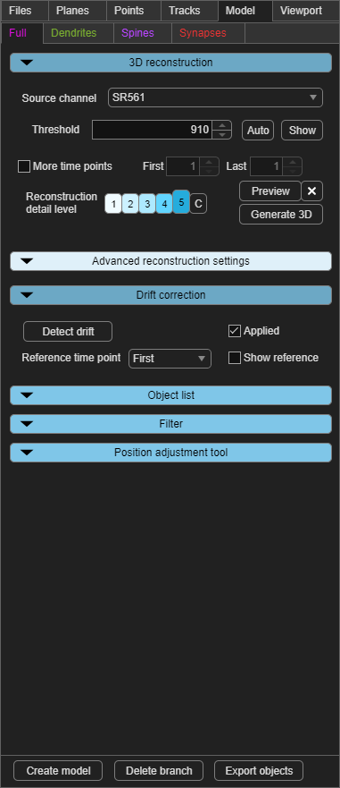

# Initialize a new model

Initialize an empty model structure before generating model parts, unless you loaded data that already contains a model.

!!! info "Before you start"
    **Prerequisites:**

    - Planes data loaded in Irbis.

    **UI location:**

    - Main app: **Model** tab.

## Steps

1. Go to the **Model** tab.
2. Press **Create model** at the bottom of the page.
3. Confirm that the model-generation options are now visible.

## Next steps

- Continue to [Create a primary 3D model](reconstruct-primary-model.md).

