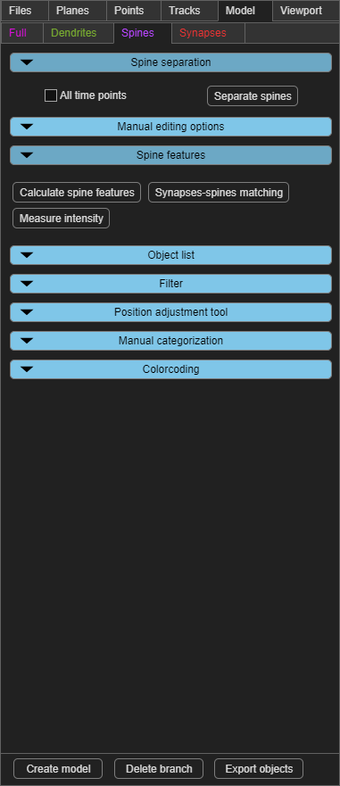
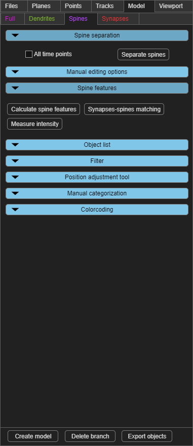
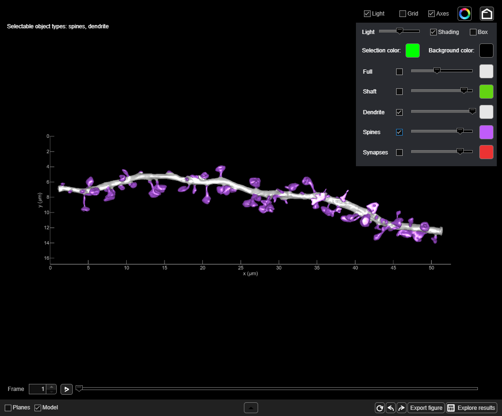

# Separate spines from the shaft

!!! info "Before you start"
    **Prerequisites:**

    - 3D model created.
    - Dendrites tracked.
    - Dendritic shaft model generated.

    **UI location:**

    - Main app: **Model** tab, **Spines** subtab, **Spine separation** section.

## Steps
1. Go to **Model** > **Spines**.
2. To generate the model for all time points, check **All time points**.
3. Press **Separate spines**.
4. When prompted, left-click the shaft used to separate spines.
5. Wait for separation to finish.

## Next steps

- Review the result with [Review and correct spine separation](review-correct-spine-separation.md).
- Continue to [Calculate spine features](calculate-spine-features.md) after the separation is acceptable.

