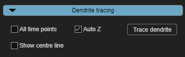
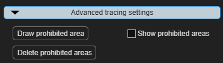

# Trace a dendrite

!!! info "Before you start"
    **Prerequisites:**

    - Primary 3D model created for all time points.
    - Time drift corrected.
    - Objects connected in time.

    **UI location:**

    - Main app: **Model** tab, **Dendrite** subtab, **Dendrite tracing** section.

## Steps

1. To trace the dendrite for every time point, check **All time points**.
2. Press **Trace dendrite**.
3. Select the object to trace by clicking it.
4. When planes data appear, left-click one end of the dendrite.
5. Left-click the other end of the dendrite.
6. If tracing fails at a time point, select the start and end points again when prompted.
7. To exit selection, press **Esc**.

This generates a centreline for the selected object.

## Add forbidden areas
The centreline may jump to a more prominent part of the image instead of following the dendrite of interest, for example when multiple dendrites cross. Prevent this by defining forbidden areas that the centreline cannot enter.

1. Open **Advanced tracing settings**.
2. Press **Draw prohibited area** to activate ROI drawing mode.
3. Draw the prohibited area point by point in the visualization panel.
4. If the ROI is wrong, press **Delete prohibited areas**.
5. After drawing the prohibited areas, repeat the tracing step.

## Next steps

- Continue to [Generate the dendritic shaft](generate-shaft.md).

