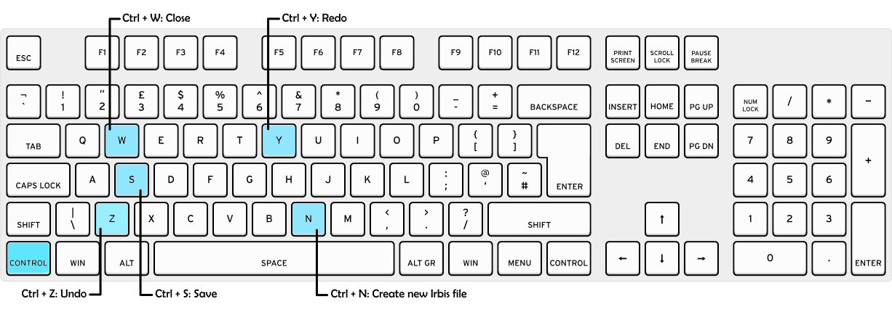
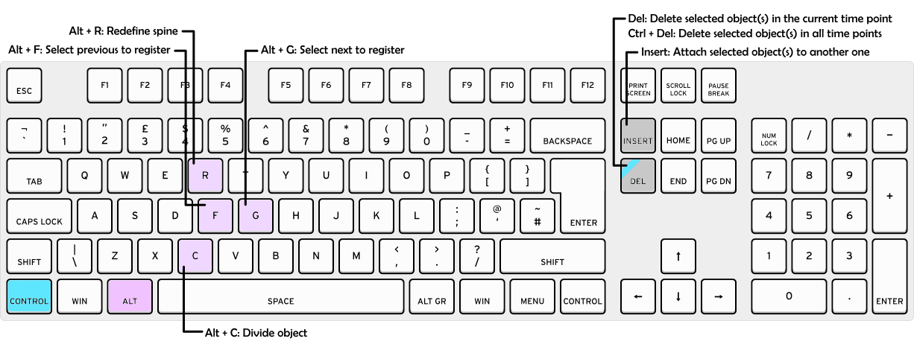
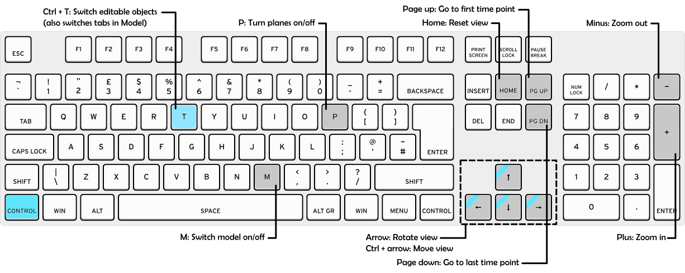

# Use keyboard shortcuts

## Shortcuts

- **Shift + scroll wheel**: scroll through z-planes.
- **Ctrl + scroll wheel**: scroll through time points.

!!! warning
    Ctrl + scroll wheel may not work in the current MATLAB version.

### General

### Object manipulation

### View orientation

## Related

- See mouse controls in [Navigate the visualization panel](navigation.md).
