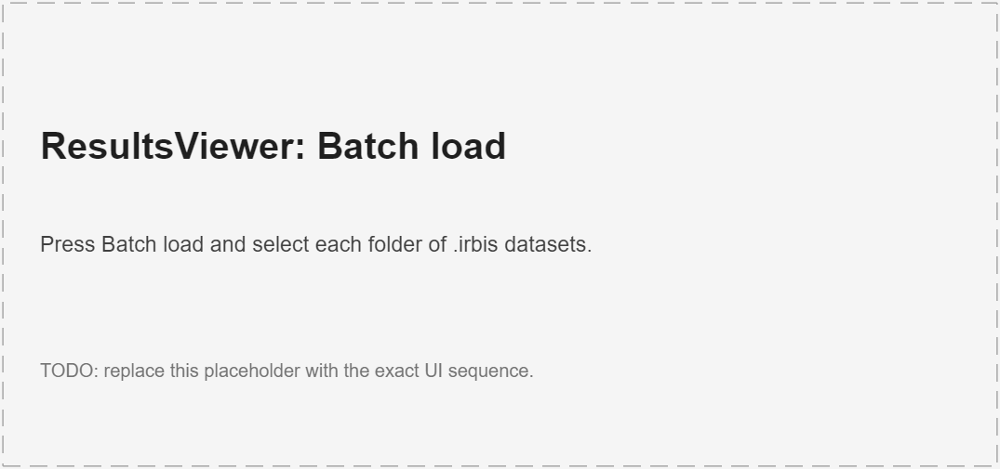
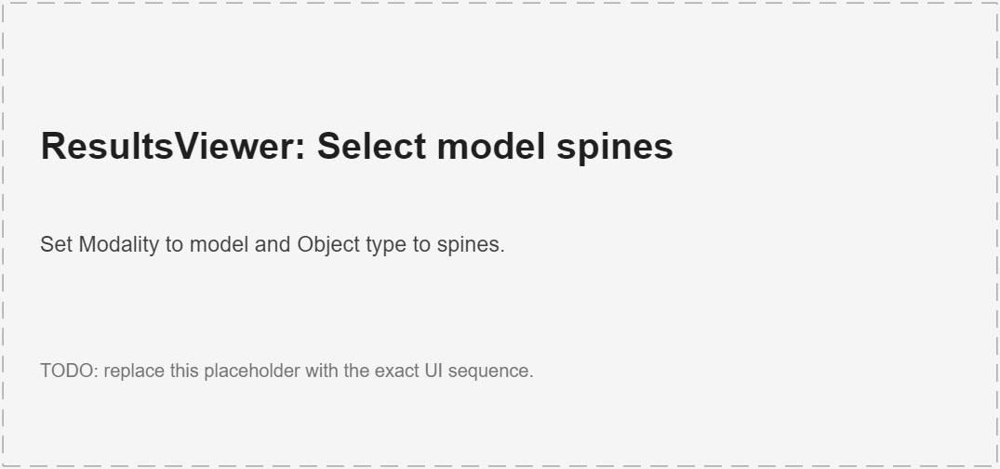
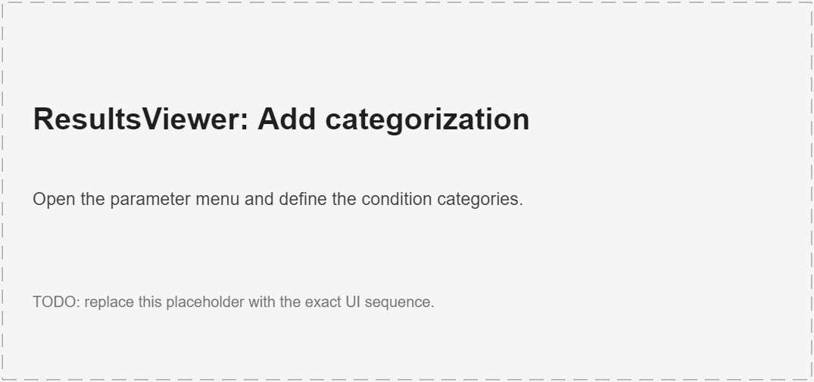
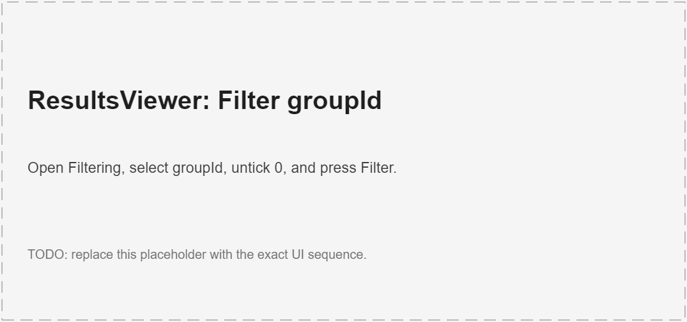
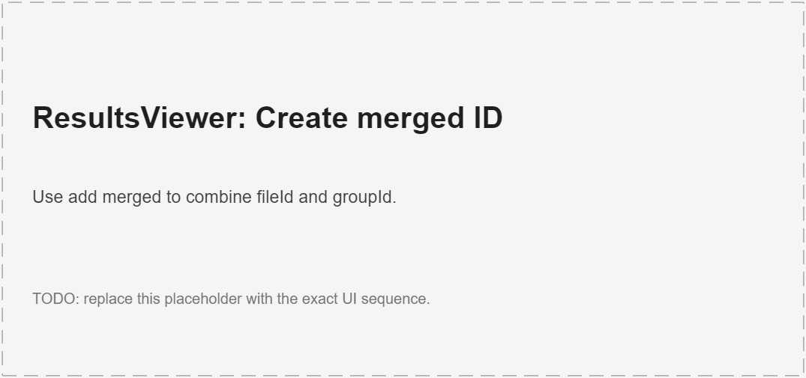
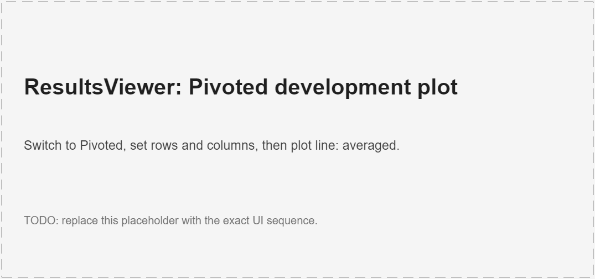
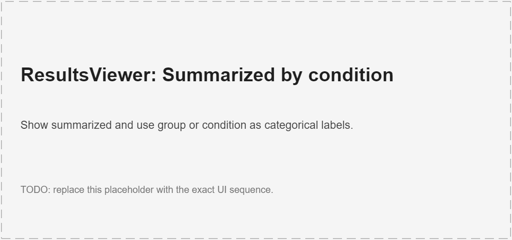
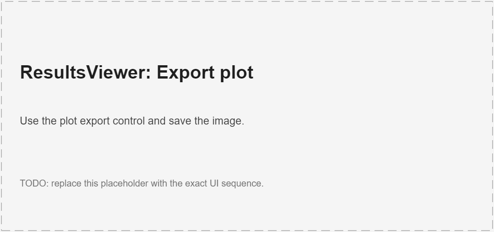
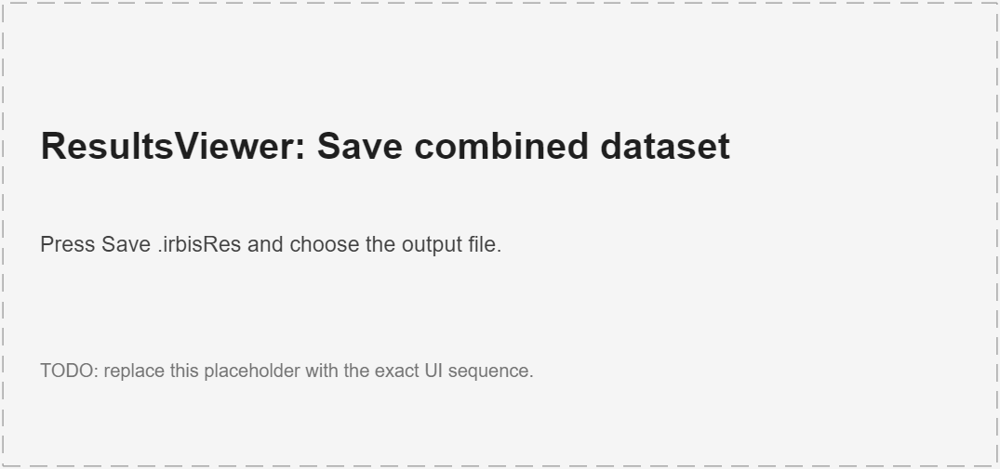

# Tutorial: compare datasets in ResultsViewer

Use this tutorial to load several datasets into ResultsViewer, add treatment categories, remove objects that are not connected over time, plot temporal development by condition, and export the result.

???+ info "Learning objectives"
    After completing this tutorial, you will be able to:

    - Combine several datasets in ResultsViewer.
    - Add categories that separate treatment and control conditions.
    - Filter out objects that are not connected across time points.
    - Plot temporal development for each condition.
    - Export plots and save the combined ResultsViewer dataset.

???+ info "Before you start"
    Before starting this tutorial, make sure that:

    - You have several datasets to compare.
    - Objects are connected across time points by group ID.
    - Features have been calculated for the objects you want to compare.
    - ResultsViewer is open.

!!! note "Folded details"
    Folded sections in this tutorial are not separate tutorial steps. They provide additional detailed information from the step-by-step guides.

## Flow

### Load datasets

1. In ResultsViewer, press **Batch load**.
2. Select the datasets from the first folder.
3. When the dialog opens again, select datasets from another folder if needed.
4. Repeat until all datasets are loaded, then press **Cancel** to close the dialog.

    

    ??? note "Use ResultsViewer in batch mode"

        --8<-- "_generated/snippets/step-by-step/results-viewer/batch-mode.md"

5. Select **model** from **Modality**.
6. Select **spines** from **Object type**.

    

If the parameter list does not contain the expected spine parameters, check that **spines** is selected as the object type. If the object type is correct, check the source dataset.

### Add treatment categories

If treatment information is already stored in the file **group** field in the **Files** tab of Irbis, use that existing category. Otherwise, create a categorization in ResultsViewer.

1. In the upper-left corner above the checkbox list, click the downwards-pointing arrow.
2. Select **add categorization**.
3. Enter `condition` in **Categorization name**.
4. Name the first category `control`.
5. Select `fileName` as the criterion and tick the files that belong to the control condition.
6. Press **Complement** and rename the new category to the treatment condition, for example `NMDA20`.
7. If you have more conditions, press **Add category** and define the extra categories.
8. Press **Save categorization**.

    

    ??? note "Define ResultsViewer categorization"

        --8<-- "_generated/snippets/step-by-step/results-viewer/categorize-data.md"

### Remove objects not connected over time

Objects with `groupId` set to `0` are not connected across time points. Remove them before plotting object development.

1. Open the **Filtering** panel at the bottom right.
2. Select the table that contains `groupId` from **Table to filter**.
3. Select `groupId` from the parameter drop-down menu.
4. Untick `0`.
5. Press **Filter**.

A filter button named `groupId` appears in the **Filtering** panel. Toggle it to temporarily disable or enable the filter.

### Create a unique object identifier

When several datasets are loaded together, `groupId` is no longer unique because different datasets can contain the same group ID. Create a merged identifier that combines the file identifier with the group ID.

1. In the upper-left corner above the checkbox list, click the downwards-pointing arrow.
2. Select **add merged**.
3. In the dialog, use `fileId` in the first drop-down menu and `groupId` in the second.
4. Press **Save**.

### Show object development over time

Use Pivoted table view to show time points as columns and connected objects as rows.

1. From the table view drop-down menu in the upper-left corner, switch from **Full** to **Pivoted**.
2. Select `solidity` from **Grouped data**, or select another parameter you want to compare.
3. Check that **Rows** uses `fileId_groupId`.
4. Check that **Columns** uses `timePoint`.
5. Select **line: averaged** from the plot type drop-down menu in the upper-right corner.
6. Click the header of the first time-point column to include all rows in the plot.

The plot should show one averaged line with a shaded confidence interval.

### Plot each condition separately

Use the summarized table to add condition labels to the selected object-development plot.

1. Press **Show summarized** in the bottom-left corner.
2. In the summarized table controls, select the `group` or `condition` column.
3. Tick **Categorical as labels** in the upper-right corner.
4. Click the header of the `group` or `condition` column.

The plot should show one averaged line with a confidence interval for each condition.

### Export the plot

1. Hover over the plot to show the plot controls in the upper-right corner.
2. Click the export icon.
3. Select the image export option, such as PNG or SVG.
4. In the dialog, choose a folder, enter a file name, and press **Save**.

### Save the combined dataset

Save the combined dataset if you want to reopen it later in ResultsViewer.

1. In the upper-left corner, press **Save .irbisRes**.
2. In the dialog, choose a folder and enter a file name.
3. Press **Save**.

