# Tutorial: segment dendritic spines from a timelapse and connect spines in time

This is an end-to-end flow for timelapse structural microscopy data. It expands on the [tutorial for a single time point](segment-spines.md) with additional steps for connecting spines in time.

???+ info "Learning objectives"
    After completing this tutorial, you will be able to:

    - Import structural fluorescence microscopy data into Irbis.
    - Register planes in xy and apply denoising.
    - Generate a 3D reconstruction of a dendritic segment from image intensity data and segment individual spines.
    - Correct merged spine segmentations manually.
    - Track individual objects in time.
    - Calculate quantitative morphological measurements for individual spines.
    - Save the project for further analysis.

???+ info "Before you start"
    Before starting this tutorial, make sure that:

    - Irbis is installed and running.
    - You have a structural microscopy dataset containing a dendrite with visible spines. The example TIFF image can be downloaded [here](https://microscopy.iem.cas.cz/irbis-downloads/control_01_ROI2.tif).
    - A processed version of the example dataset is available [here](https://microscopy.iem.cas.cz/irbis-downloads/control_01_ROI2_processed.irbis) if you want to compare your result with a finished `.irbis` file.

!!! note "Folded details"
    Folded sections in this tutorial are not separate tutorial steps. They provide additional detailed information from the step-by-step guides.

!!! info "Timelapse-related steps"
    This tutorial expands the [simpler tutorial for a single time point](segment-spines.md). Many steps are the same, so steps that are specific to timelapse data are labeled as TS (timelapse-specific) for easier orientation.

## Flow

### Load and view structural data

1. Load structural data by going to the **Files** tab, pressing **New**, and selecting **Import planes** in the pop-up window.

    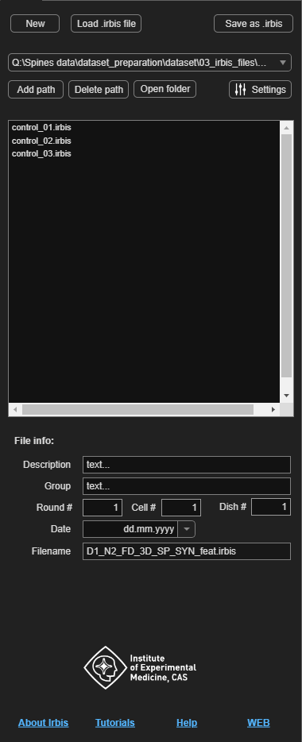

    ??? note "Load data"

        --8<-- "_generated/snippets/step-by-step/data-import/load-data.md"

2. Use the controls in the **Planes** tab to view the structural data and navigate through the z-stack.

    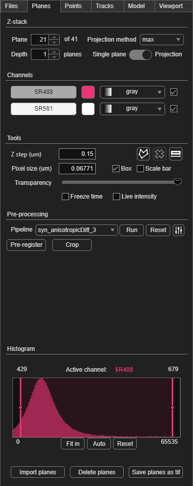

    ??? note "View data"

        --8<-- "_generated/snippets/step-by-step/planes/view-raw-data.md"

3. For the example dataset, correct the axial scaling before segmentation. The dendrite appears stretched in z because the data were acquired with an oil-immersion objective while the cells were in a water-based solution. This refractive-index mismatch can cause sample-induced spherical aberration and axial distortion, as described by [Diel et al., 2020](https://www.nature.com/articles/s41596-020-0360-2). To correct the example dataset, change **Z step** from **0.2 um** to **0.16 um**.

### TS: Register planes in xy

1. In the **Planes** tab, in the **Channels** section, make sure that the channel containing structural data is active. You can activate it by clicking the button with the corresponding channel name. (*In the example dataset, activate ch2.*)
2. In the **Pre-processing** section, press the **Pre-register** button.
3. A new window should appear, showing maximum-intensity projections of the selected channel at different time points overlaid with the reference time point. At the bottom of that window, press **Register**. The visualized MIPs should align with their reference. If you are satisfied with the registration, press **Accept**.

    ??? note "Register planes in xy"

        --8<-- "_generated/snippets/step-by-step/planes/align-planes.md"

### Apply denoising

1. In the **Planes** tab, in the **Channels** section, make sure that the channel containing structural data is active. You can activate it by clicking the button with the corresponding channel name. (*In the example dataset, activate ch2.*)
2. In the **Planes** tab, in the **Pre-processing** section, click the settings icon button. This opens the Image Morphing Mighty Duck window, where you can define preprocessing steps.
3. In the new window, press **New**.
4. Press the **+** button and select the filter you want to use. (*For the example dataset, we used Spatial filter - Non-local means.*)
5. A new block should appear in the pipeline. If relevant, select the desired values for its adjustable parameters. (*For the example dataset, we used degree of smoothing (DoS) equal to 2.*)
6. Press **Preview** to visualize the effect of the filtering pipeline on your image.
7. When you are satisfied with your preprocessing pipeline, press **Save** and specify the name of your pipeline.
8. Close the preprocessing window.
9. Back in the main Irbis window, select the preprocessing pipeline you just created from the drop-down menu and press **Run**. **This applies the selected pipeline only to the currently active channel.**

### Generate model

#### Reconstruct the full dendrite

1. Initialize the model by navigating to the bottom of the **Model** tab and pressing **Create model**. The model-generation controls should appear.

    ??? note "Initialize a model structure"

        --8<-- "_generated/snippets/step-by-step/model/initialize-model.md"

    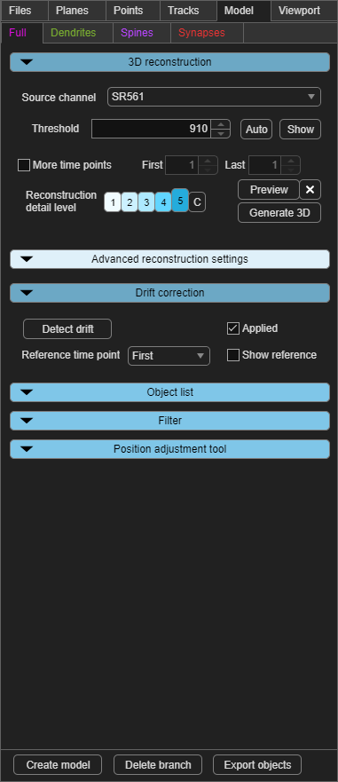

2. To generate the full dendrite reconstruction, go to **Model** > **Full** and open **3D reconstruction**. Select the channel you want to reconstruct from the drop-down menu (*ch2 for the example dataset*) and press **Auto** to find a suitable intensity threshold. Press **Show** to preview the foreground region, which is overlaid in gray on the data in the right panel. When the threshold looks correct, press **Generate 3D** and wait for reconstruction to finish. (*For the example dataset, we used a threshold of 1100.*)

    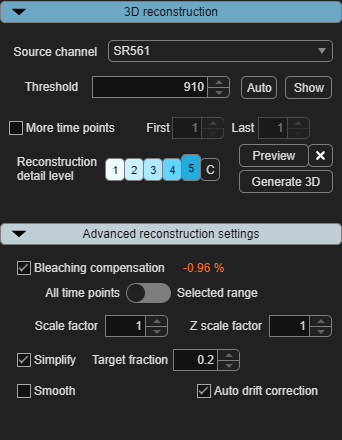

    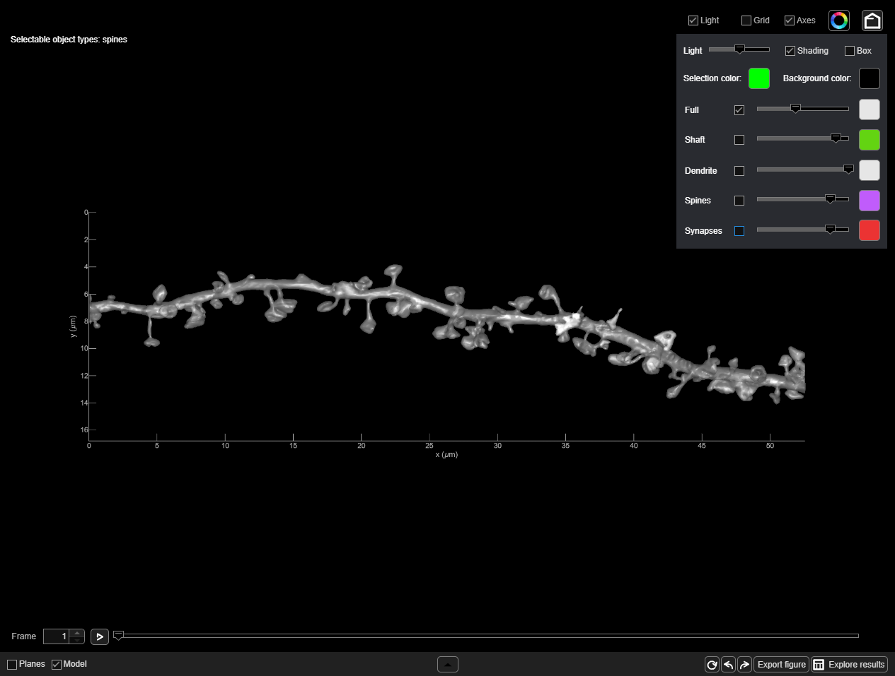

    ??? note "Generate full dendrite reconstruction"

        --8<-- "_generated/snippets/step-by-step/model/reconstruct-primary-model.md"

3. If the reconstruction needs adjustment, enter a different threshold value and press **Generate 3D** again.
4. TS: Once you are satisfied with the reconstruction in the current time point, check the **More time points** checkbox and press **Generate 3D** again to process all time points.
5. TS: Once the reconstruction is finished, click the model in the visualization panel (it should be highlighted in green) and scroll through the time points. If it stays highlighted in green, it has been successfully connected in time.
6. TS: If the connection is not correct, open the **Object list** section, increase the **Radius limit**, and press **Track objects**.
7. TS: Alternatively, select the dendrite you want to track in the visualization panel, right-click it, and select **Single: Select next** from the context menu. The visualization switches to the next time point, where you can click the corresponding dendrite to connect them.

#### Generate shaft model

*In the next steps, you will generate a dendritic shaft model. The shaft is used to separate spines from the dendrite centre. This happens in two steps: first trace the dendrite, then use the resulting centreline together with the full dendrite model to generate the shaft.*

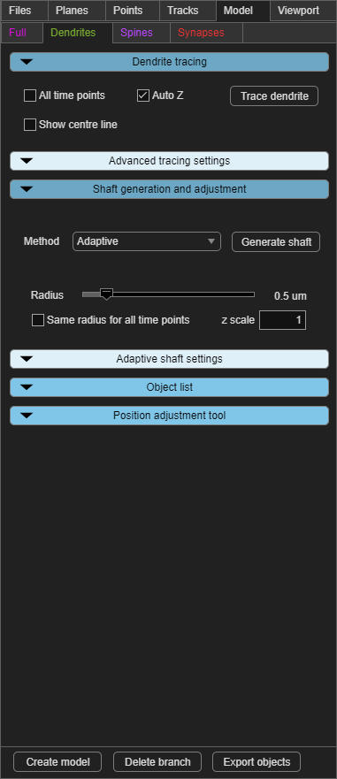

1. To trace the dendrite, go to **Model** > **Dendrite** and open **Dendrite tracing**.
2. TS: Check the **All time points** checkbox.
3. Press **Trace dendrite**, then click the dendrite you want to trace. When the planes are shown, left-click one end of the dendrite and then the other. A centreline appears in the visualization panel.

    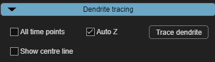

    ??? note "Trace dendrite"

        --8<-- "_generated/snippets/step-by-step/model/trace-dendrite.md"

4. To generate the shaft model, stay in the same tab and open **Shaft generation and adjustment**. Select **Adaptive** from the **Method** drop-down menu, press **Generate shaft**, and wait for generation to finish.

    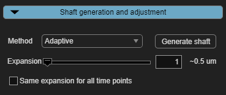

    ??? note "Generate shaft"

        --8<-- "_generated/snippets/step-by-step/model/generate-shaft.md"

5. The shaft model should cover the dendrite centre and wrap tightly around it without covering too much of the spines. If it is too thin or too thick, adjust its thickness with the **Expansion** slider. (*For the example dataset, we used an expansion of 1.3.*)

    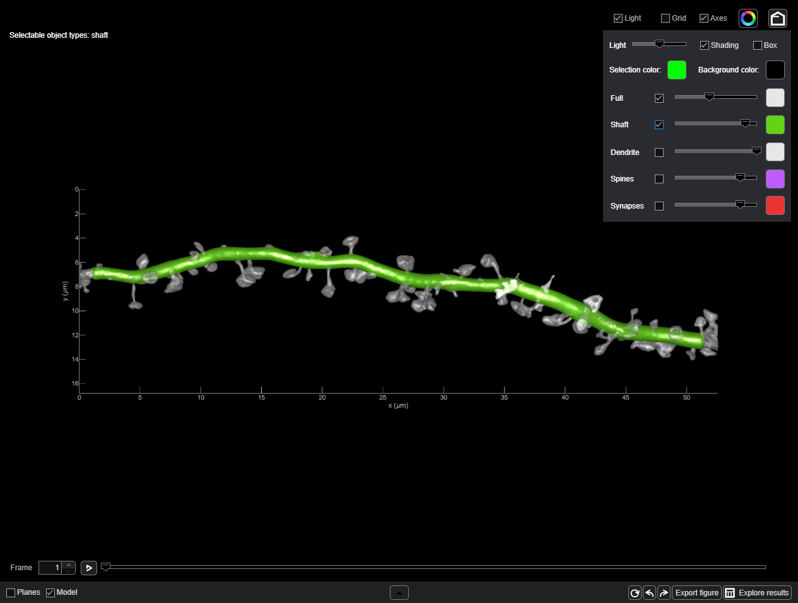

6. TS: Make sure that the shaft model is connected in time by selecting it and checking that it stays highlighted when you scroll through time points.

#### Segment spines 

*Now you will separate the spines. Everything extending outside the shaft is treated as a spine. If two or more spines are close together, they may be merged and require manual separation.*

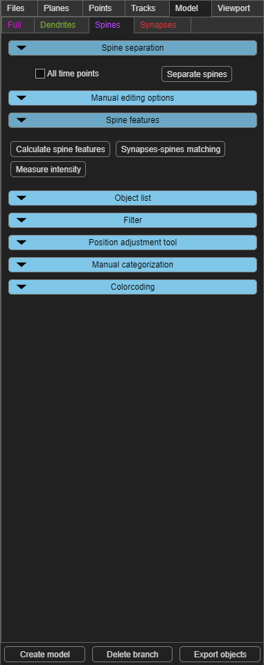

1. To separate the spines from the shaft, go to **Model** > **Spines** and open **Spine separation**.
2. TS: Check the **All time points** checkbox.
3. Press **Separate spines**, click on the shaft you want to use for segmentation and wait for separation to finish.

    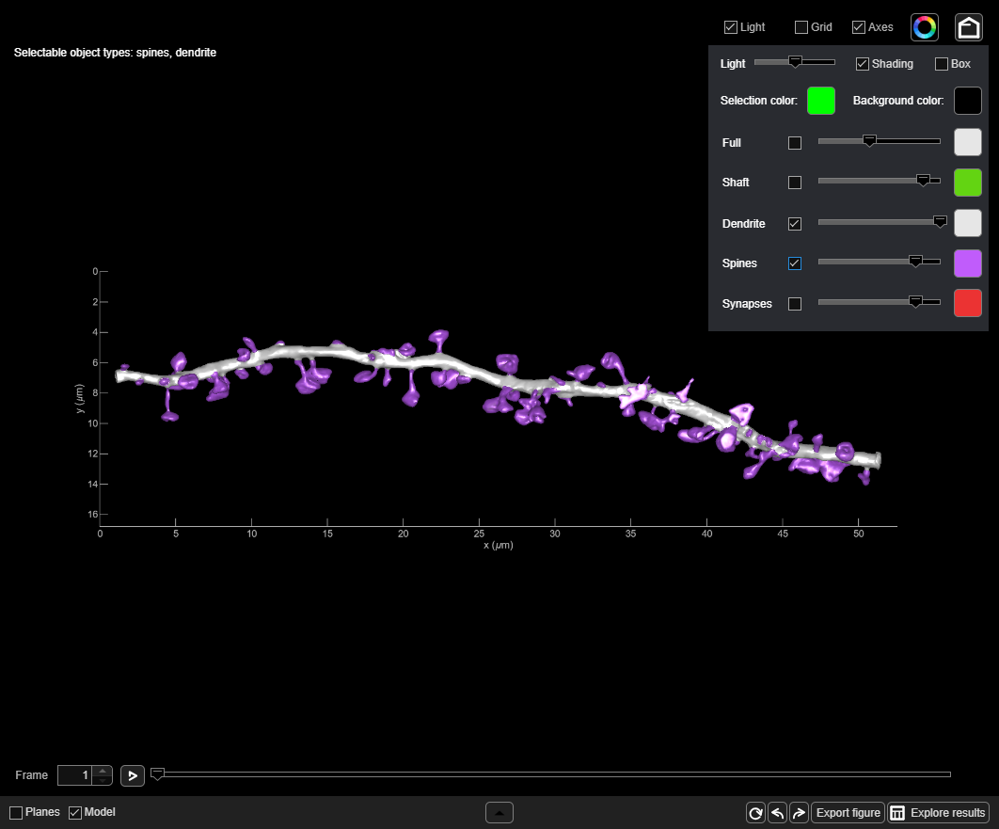

    ??? note "Separate spines"

        --8<-- "_generated/snippets/step-by-step/model/separate-spines.md"

4. TS: Open the **Manual editing options** section and press **Find cuts** to search for candidate cuts. This tool looks for spines that are connected in one time point but separated in another, then opens a review window. For each merged spine, check and correct the position of the gizmo. Press **Approve selected cut** if the position is correct, or **Reject selected cut** otherwise. If there are multiple gizmos in the same view, you can switch between them in the drop-down menu in the lower-right corner. Once you have reviewed all cut candidates, or when you want to stop reviewing the current candidates, press **Finish review**.

    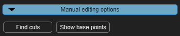

5. Review the separated spines. Use **Show base points** to visualize where spines are connected to the shaft. If there are spines merged together, left-click them in the right panel, right-click to open the context menu and select **Single: Suggest division plane**. A cutting tool appears; move it by dragging the tip points and rotate it by dragging the circles. When the cutting plane is positioned correctly, press Enter to finish the cut.

    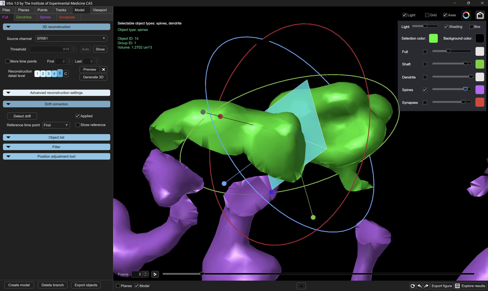

    ??? note "Review and correct spine separation"

        --8<-- "_generated/snippets/step-by-step/model/review-correct-spine-separation.md"

6. TS: In the **Objects list** section, press **Track objects** to connect spines in time. Press **Plot timelapse** or **Plot timelapse (all)** to visualize the sequence of objects.

*Object correspondence across time points is stored in the groupID value. The groupID is shown in the objects table in the Objects list section. When you click an object, it is also shown in brackets in the object label and in the upper-left corner of the visualization panel.*

7. TS: If an object is not tracked correctly, you have several editing options. You can check the **Edit groupIDs** checkbox and edit the values manually in the objects table. Alternatively, select the object you want to track, right-click it, and select **Single: Select next** (to connect it with the subsequent time point) or **Single: Select previous** (to connect it with the previous time point).

8. Open **Spine features** and press **Calculate spine features** to calculate parameters for all spines.

    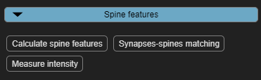

    ??? note "Calculate spine features"

        --8<-- "_generated/snippets/step-by-step/model/calculate-spine-features.md"

9. If you want to assign manual classes to spines, open **Manual categorization**, choose or define a categorization, select spines and assign them to the chosen category.

    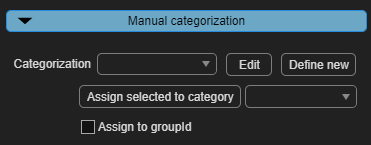

    ??? note "Classify spines manually"

        --8<-- "_generated/snippets/step-by-step/model/classify-spines-manually.md"

### Saving and exporting data

1. Save the dataset as an `.irbis` file by going to the **Files** tab and pressing **Save as .irbis**. Alternatively, use the **Ctrl + S** keyboard shortcut.

    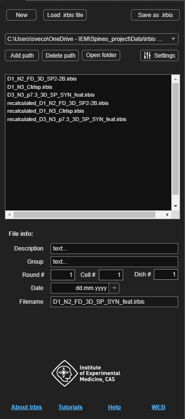
