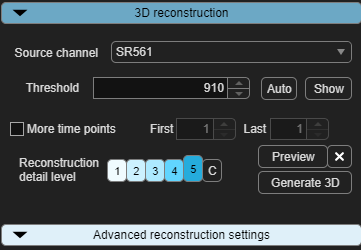
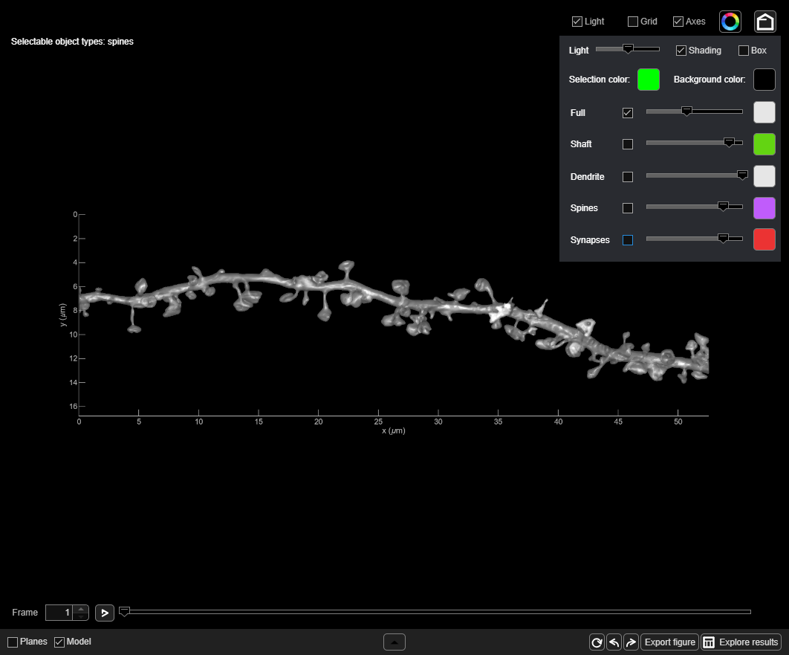
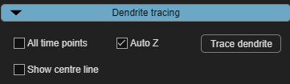
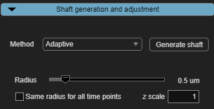
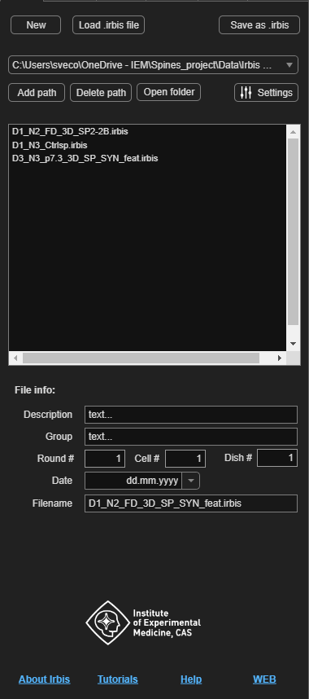

# Tutorial: segment dendritic spines from a single time point

This is the main end-to-end flow for structural microscopy data.

???+ info "Learning objectives"
    After completing this tutorial, you will be able to:

    - Import structural fluorescence microscopy data into Irbis.
    - Generate a 3D reconstruction of a dendritic segment from image intensity data and segment individual spines.
    - Correct merged spine segmentations manually.
    - Calculate quantitative morphological measurements for individual spines.
    - Save the project for further analysis.

???+ info "Before you start"
    Before starting this tutorial, make sure that:

    - Irbis is installed and running.
    - You have a structural microscopy dataset containing a dendrite with visible spines.
    - The dataset has already been acquired and does not require preprocessing outside Irbis.

!!! note "Folded details"
    Folded sections in this tutorial are not separate tutorial steps. They provide additional detailed information from the step-by-step guides.

## Flow

### Load and view structural data

1. Load structural data by going to the **Files** tab, clicking on **New** and selecting **Import planes** in the pop-up window. 

    

    ??? note "Load data"

        --8<-- "_generated/snippets/step-by-step/data-import/load-data.md"

2. Use the controls in the **Planes** tab to view the structural data and navigate through the z-stack. 

    

    ??? note "View data"

        --8<-- "_generated/snippets/step-by-step/planes/view-raw-data.md"

### Generate model

3. Start model reconstruction by navigating to the bottom of the **Model** tab and clicking on **Create model**. This should show all the necessary controls. 

    ??? note "Initialize a model structure"

        --8<-- "_generated/snippets/step-by-step/model/create-model.md"

4. To generate the full dendrite reconstruction, go to the **Model** tab to the **Full** section and navigate to the **3D reconstruction** panel. Select the channel you want to reconstruct from the drop-down menu and press **Auto** to find a suitable intensity threshold. Click **Show** to preview the foreground region, which will be overlaid as gray over the data in the right panel. When you are happy with the selected threshold, click **Generate 3D** and wait a bit.

    

    

    

    ??? note "Generate full dendrite reconstruction"

        --8<-- "_generated/snippets/step-by-step/model/reconstruct-primary-model.md"

5. If you are unhappy with the reconstruction, input a different threshold value and click on **Generate 3D again**.

*Now, you need to generate a model of the dendritic shaft that will be used to separate the spines from the centre. This happens in two steps - first, the dendrite is traced, and the output centreline is then used together with the full dendrite model to create the model of the shaft.*

6. To trace the dendrite, go to the **Model** tab to the **Dendrites** section and navigate to the **Trace dendrite** panel. There, click on **Trace dendrite**. Afterwards, click on the dendrite you want to trace. When the planes are shown, left-click first on one end of the dendrite and then on the other. After a few moments, a centreline should appear over the visualization in the right panel.

    

    ??? note "Trace dendrite"

        --8<-- "_generated/snippets/step-by-step/model/trace-dendrite.md"

7. To generate the shaft model, stay in the same tab and navigate down to the **Shaft generation and adjustment** panel. Click on **Generate shaft** and wait a bit. 

    

    ??? note "Generate shaft"

        --8<-- "_generated/snippets/step-by-step/model/generate-shaft.md"

8. The shaft model has to cover the centre of the dendrite and wrap tightly without covering too much from the spines. If it is too thin or thick, adjust its thickness with the **Radius** slider. 

    

*Now it is time to separate spines. Everything that is sticking outside of the shaft will be considered a spine. If there are two or more spines close together, they might be merged, which then requires manual separation.*

9. To separate the spines from the shaft, go to the **Model tab** to the **Spines** section and navigate to the **Spine separation** panel. Click on **Separate spines** and wait a bit. 

    

    ??? note "Separate spines"

        --8<-- "_generated/snippets/step-by-step/model/separate-spines.md"

10. If there are spines merged together, left-click on them in the right panel. Then, activate the context menu by right-click and select **Single: Suggest division plane**. A cutting tool should appear, that you can move by holding and dragging the tip-points and rotate by dragging on the circles. When the cutting plane is positioned correctly, press Enter to finish the cutting. 

11. In the same tab, navigate to the **Spine features** section and click on **Calculate spine features** to calculate parameters for all spines. 

### Saving and exporting data

12. Save the dataset as .irbis file by going to **Files** tab and clicking on **Save as .irbis**. Alternatively, you can use Ctrl + S keyboard shortcut.

    
