# Tutorial: segment dendritic spines from a single time point

This is a simplified end-to-end flow for structural microscopy data.

???+ info "Learning objectives"
    After completing this tutorial, you will be able to:

    - Import structural fluorescence microscopy data into Irbis.
    - Generate a 3D reconstruction of a dendritic segment from image intensity data and segment individual spines.
    - Correct merged spine segmentations manually.
    - Calculate quantitative morphological measurements for individual spines.
    - Save the project for further analysis.

???+ info "Before you start"
    Before starting this tutorial, make sure that:

    - Irbis is installed and running.
    - You have a structural microscopy dataset containing a dendrite with visible spines. The example TIFF image can be downloaded [here](https://microscopy.iem.cas.cz/irbis-downloads/control_01_ROI2_ch2_t1.tif).

!!! note "Folded details"
    Folded sections in this tutorial are not separate tutorial steps. They provide additional detailed information from the step-by-step guides.

## Flow

### Load and view structural data

1. Load structural data by going to the **Files** tab, pressing **New**, and selecting **Import planes** in the pop-up window.

    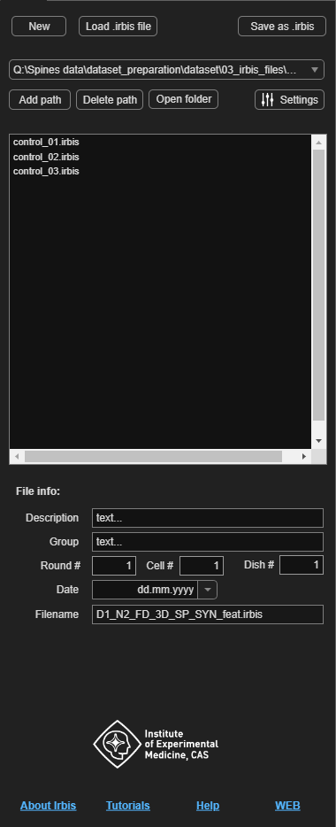

    ??? note "Load data"

        --8<-- "_generated/snippets/step-by-step/data-import/load-data.md"

2. Use the controls in the **Planes** tab to view the structural data and navigate through the z-stack.

    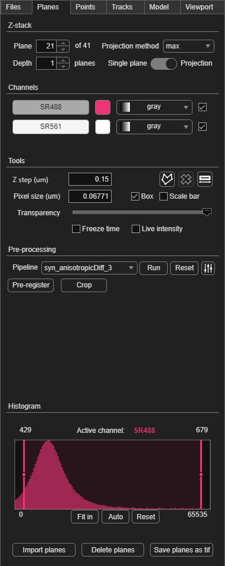

    ??? note "View data"

        --8<-- "_generated/snippets/step-by-step/planes/view-raw-data.md"

### Generate model

3. Initialize the model by navigating to the bottom of the **Model** tab and pressing **Create model**. The model-generation controls should appear.

    ??? note "Initialize a model structure"

        --8<-- "_generated/snippets/step-by-step/model/initialize-model.md"

    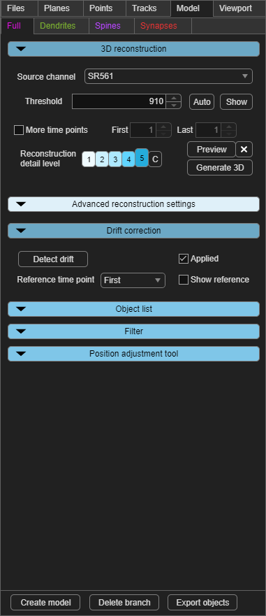

4. To generate the full dendrite reconstruction, go to **Model** > **Full** and open **3D reconstruction**. Select the channel you want to reconstruct from the drop-down menu and press **Auto** to find a suitable intensity threshold. Press **Show** to preview the foreground region, which is overlaid in gray on the data in the right panel. When the threshold looks correct, press **Generate 3D** and wait for reconstruction to finish.

    

    

    ??? note "Generate full dendrite reconstruction"

        --8<-- "_generated/snippets/step-by-step/model/reconstruct-primary-model.md"

5. If the reconstruction needs adjustment, enter a different threshold value and press **Generate 3D** again.

*In the next steps, you will generate a dendritic shaft model. The shaft is used to separate spines from the dendrite centre. This happens in two steps: first trace the dendrite, then use the resulting centreline together with the full dendrite model to generate the shaft.*

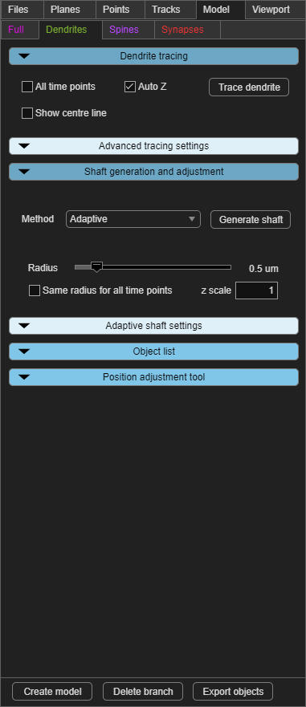

6. To trace the dendrite, go to **Model** > **Dendrite** and open **Dendrite tracing**. Press **Trace dendrite**, then click the dendrite you want to trace. When the planes are shown, left-click one end of the dendrite and then the other. A centreline appears in the visualization panel.

    

    ??? note "Trace dendrite"

        --8<-- "_generated/snippets/step-by-step/model/trace-dendrite.md"

7. To generate the shaft model, stay in the same tab and open **Shaft generation and adjustment**. Select **Adaptive** from the **Method** drop-down menu, press **Generate shaft**, and wait for generation to finish.

    

    ??? note "Generate shaft"

        --8<-- "_generated/snippets/step-by-step/model/generate-shaft.md"

8. The shaft model should cover the dendrite centre and wrap tightly around it without covering too much of the spines. If it is too thin or too thick, adjust its thickness with the **Expansion** slider.

    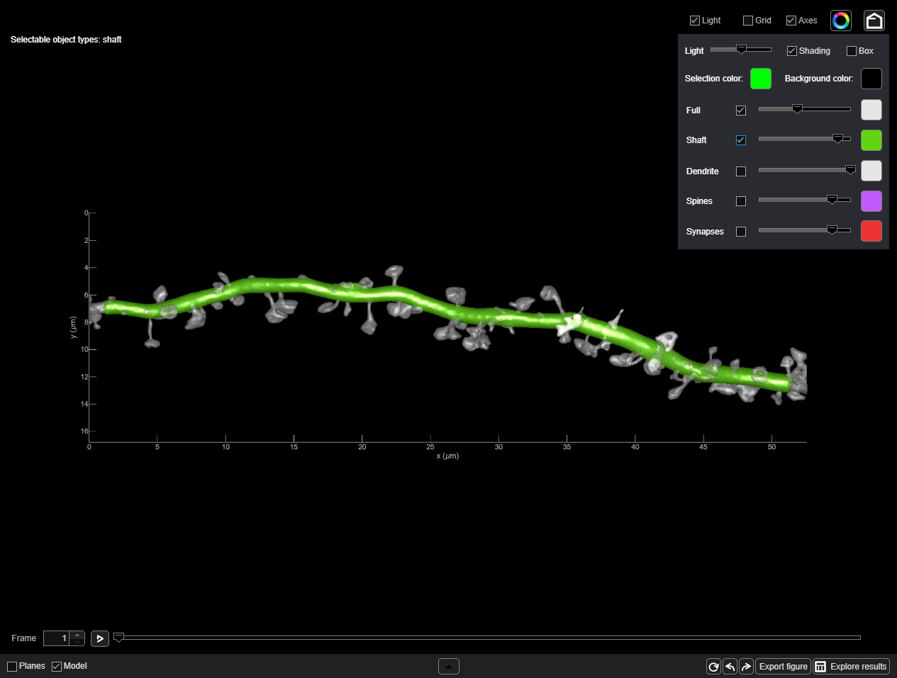

*Now you will separate the spines. Everything extending outside the shaft is treated as a spine. If two or more spines are close together, they may be merged and require manual separation.*

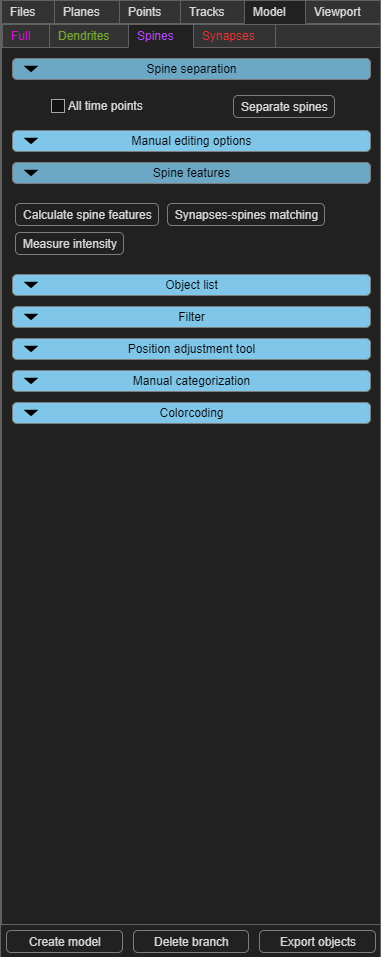

9. To separate the spines from the shaft, go to **Model** > **Spines** and open **Spine separation**. Press **Separate spines** and wait for separation to finish.

    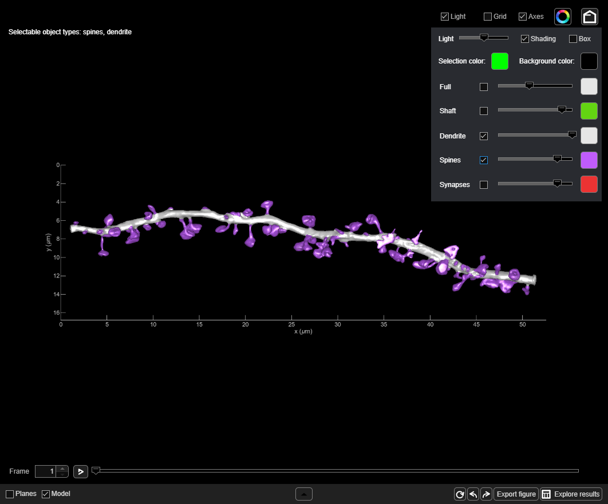

    ??? note "Separate spines"

        --8<-- "_generated/snippets/step-by-step/model/separate-spines.md"

10. Review the separated spines. Use **Show base points** to visualize where spines are connected to the shaft. If there are spines merged together, left-click them in the right panel, right-click to open the context menu and select **Single: Suggest division plane**. A cutting tool appears; move it by dragging the tip points and rotate it by dragging the circles. When the cutting plane is positioned correctly, press Enter to finish the cut. (If you have a dataset with more time points, use **Find cuts** to search for candidate cuts. This tool looks for spines that are connected in one time point but separated in another, then uses that information to place the gizmo.)

    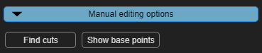

    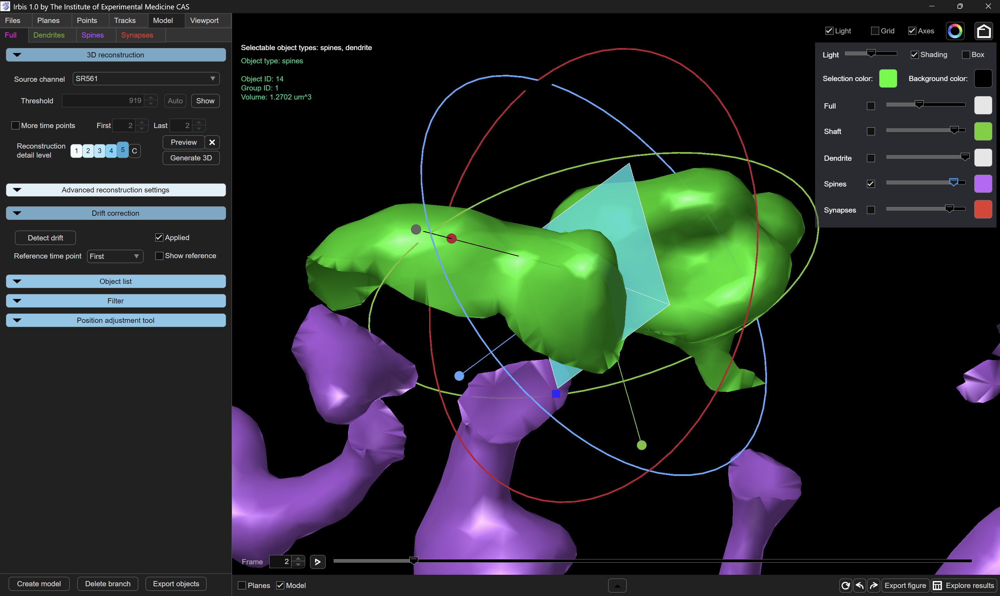

    ??? note "Review and correct spine separation"

        --8<-- "_generated/snippets/step-by-step/model/review-correct-spine-separation.md"

11. In the same tab, open **Spine features** and press **Calculate spine features** to calculate parameters for all spines.

    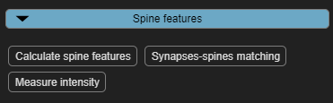

    ??? note "Calculate spine features"

        --8<-- "_generated/snippets/step-by-step/model/calculate-spine-features.md"

12. If you want to assign manual classes to spines, open **Manual categorization**, choose or define a categorization, select spines and assign them to the chosen category.

    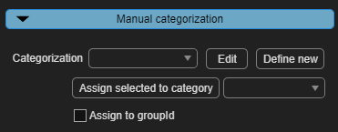

    ??? note "Classify spines manually"

        --8<-- "_generated/snippets/step-by-step/model/classify-spines-manually.md"

### Saving and exporting data

13. Save the dataset as an `.irbis` file by going to the **Files** tab and pressing **Save as .irbis**. Alternatively, use the **Ctrl + S** keyboard shortcut.

    
